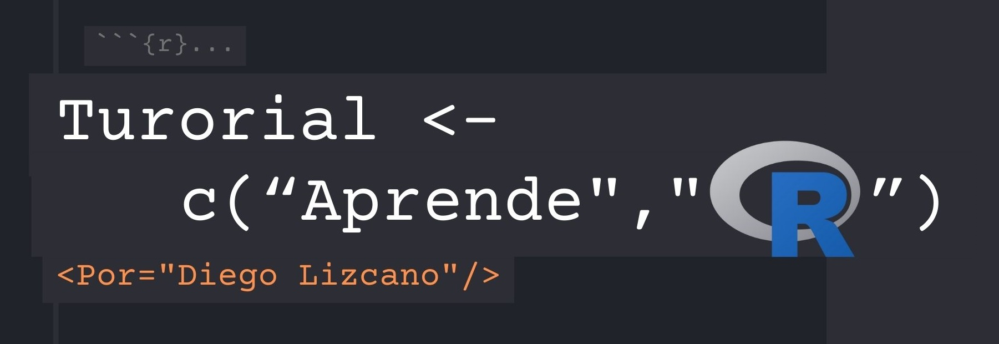

---
project:
  type: website

website:
  title: "Introducción al procesamiento, visualización y análisis de datos espaciales en R"
  subtitle: "Un mini curso"
  author: "Diego J. Lizcano & Andres Felipe Suárez-Castro"
  citation: 
    url: https://dlizcano.github.io/spataldata_2026/
  google-scholar: true
  page-navigation: true
  navbar:
    right:
      - icon: github
        href: https://github.com/dlizcano/spataldata_2026
        aria-label: GitHub
        
execute: 
  echo: true
  eval: true
  warning: false
  error: false
  output: asis
  
  
format: 
  html: 
    code-fold: true
    code-summary: "codigo R"
    highlight-style: breezedark
    fig-width: 8
    fig-height: 6
---

## Estructura del curso

Este es un curso de un día para el VI Congreso Colombiano de mastozoología.\
[](https://www.mamiferoscolombia.org/VICCM/)

### Día 1 en la mañana

Introducción al análisis de datos en R. Tipos de objetos en R. Visualización para comprobar errores y patrones en los datos (ggplot) Preparación de tablas para la generación de análisis espaciales (dplyr – tidyr). Vea la pestaña mañana

### Día 1 en la tarde

Importación y visualización de datos espaciales (ps, sf, raster, rgdal). Generación de mapas (raster, ggmap, leaflet). Vea la pestaña tarde.

### Datos

Los datos requeridos para completar el curso pueden ser descargados de Internet.

### Requisitos

Computador con acceso a Internet. Contar con R y RStudio previamente instalados. La instalación del programa no se explicará durante el curso.

Antes del curso instalar los paquetes:

```{r}
#| eval: false
#| 
install.packages("tidyverse")
install.packages("rgbif")
install.packages("sf")
install.packages("terra")
install.packages("mapview")
install.packages("maps")
install.packages("elevatr")


```

La experiencia requerida en R es mínima, sin embargo, se espera que los participantes estén familiarizados con los objetos básicos de R: vectores, dataframes y listas. Asi como la forma de indexarlos. Puedes ver aprender o repasar el manejo básico de R en este tutorial.

[](https://dlizcano.github.io/IntroR)

También se requiere, un conocimiento básico sobre los conceptos relacionados con sistemas de coordenadas, proyecciones geográficas, y SIG, aunque no es esencial.
